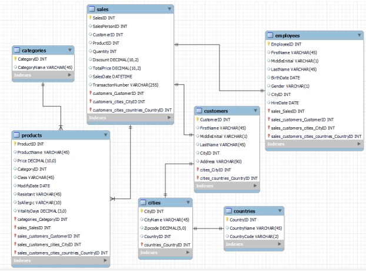
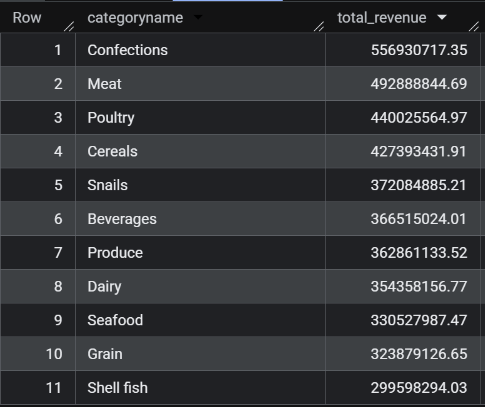

# RevoGrocers Sales Performance Analysis (SQL)

Sales performance analysis per product category for a fictional grocery retailer, using **SQL on Google BigQuery**.
Final project of the **RevoU Full Stack Data Analytics (FSDA) program, 2026**.

**Author:** Johannes Krysosthomus Thedens Dominggu ([LinkedIn](https://www.linkedin.com/in/johannes-krysosthomus-thedens-dominggu/))

📄 **Full presentation:** [RevoGrocers_Sales_Performance_Analysis.pdf](presentation/RevoGrocers_Sales_Performance_Analysis.pdf)

---

## 📌 Project Overview

RevoGrocers is a **fictional** grocery retail business that operates in several locations and sells everyday products.
The company wants to optimize its sales strategy, improve customer experience, and grow revenue through data-driven decision-making.

> **Disclaimer:** RevoGrocers is not a real company. All analysis is based on the public
> [Grocery Sales Dataset on Kaggle](https://www.kaggle.com/datasets/andrexibiza/grocery-sales-dataset).

## ❓ Business Problem

RevoGrocers wants to understand sales performance across its product categories.

**Business question (SMART):**
> How can RevoGrocers optimize the sales performance of each product category **(Specific)**, based on revenue after discount, sales volume, customer characteristics, average product price, contribution to total revenue, repeat purchase rate, and the behavior of its highest-value customers **(Measurable)**, to create business strategies **(Achievable)** that increase company revenue **(Relevant)** in the coming years **(Time-bound)**?

## 🗂️ Dataset

The main tables used are **`sales`**, **`products`**, and **`categories`**.



**Revenue formula used:** `Quantity × Price × (1 − Discount)`

## 🛠️ Tools

- **Google BigQuery** (SQL): JOIN, GROUP BY, aggregate functions, CTE (`WITH`), window functions (`SUM() OVER`), `CASE WHEN`
- **Google Slides** for the presentation

## 📁 Repository Structure

```
├── README.md
├── sql/            # 8 SQL queries, one per analysis
├── images/         # ERD and query result screenshots
└── presentation/   # Final presentation (PDF)
```

## 🔍 Analysis & Results

| # | Analysis | Query | Result |
|---|----------|-------|--------|
| 1 | Total revenue per category | [SQL](sql/01_total_revenue_per_category.sql) | [Result](images/01_result.png) |
| 2 | Revenue vs units sold | [SQL](sql/02_revenue_vs_units_sold.sql) | [Result](images/02_result.png) |
| 3 | Revenue vs unique customers | [SQL](sql/03_revenue_vs_unique_customers.sql) | [Result](images/03_result.png) |
| 4 | Average price per category | [SQL](sql/04_avg_price_per_category.sql) | [Result](images/04_result.png) |
| 5 | Average price vs unique customers | [SQL](sql/05_avg_price_vs_unique_customers.sql) | [Result](images/05_result.png) |
| 6 | Revenue contribution (%) | [SQL](sql/06_revenue_contribution_pct.sql) | [Result](images/06_result.png) |
| 7 | Repeat purchase rate | [SQL](sql/07_repeat_purchase_rate.sql) | [Result](images/07_result.png) |
| 8 | Top customer cumulative sales | [SQL](sql/08_top_customer_cumulative_sales.sql) | [Result](images/08_result.png) |

**Example: Total revenue per category (query 1)**



## 💡 Key Insights

1. **Confections is the best-performing category.** It has the highest total revenue, the highest revenue contribution (**12.87%**), the highest repeat purchase rate (**99.85%**), and the most unique customers.
2. **More units and more customers usually mean more revenue, but not always.** Some categories earn more revenue despite lower sales volume or fewer customers.
3. **Average price does not drive customers or revenue.** Grain has the highest average price, but not the highest revenue or number of customers.
4. **Shell fish has the lowest revenue and revenue contribution (6.92%),** even though its number of unique customers is similar to other categories. This suggests lower transaction value or purchase frequency.
5. **There are high-value customers.** The top customer (ID 94800) has a very high cumulative transaction value.

## ✅ Business Recommendations

| Area | Priority | Recommendation |
|------|----------|----------------|
| **Category Performance** | High | Keep the current strategy for Confections as the flagship category, and evaluate Shell fish to increase its revenue contribution. |
| **Pricing Strategy** | Medium | Review the pricing strategy for Grain so it fits better with its sales performance and number of customers. |
| **Customer Retention** | High | Maintain loyalty in categories with high repeat purchase rates, and target top customers with a loyalty program. |

## 📝 Notes

- The queries were run in a BigQuery sandbox project (`fsda-sql-01.grocery_dataset`). To run them yourself, upload the Kaggle CSV files to your own BigQuery project and replace the project and dataset names.
- Query 8 calculates spending **without** the discount, unlike the other revenue queries. Using `price * Quantity * (1 - Discount)` would make it consistent.
